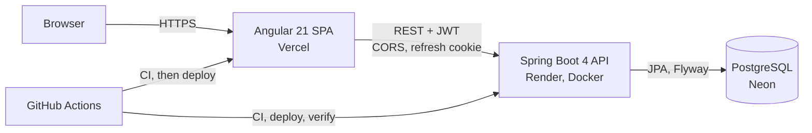

<div align="center">

# InvoiceFlow

**Invoicing for the French e-invoicing reform: compliant invoices, payment tracking and an AI assistant.**

[](https://github.com/BrahimNJ/InvoiceFlow/actions/workflows/backend-ci.yml)
[](https://github.com/BrahimNJ/InvoiceFlow/actions/workflows/frontend-ci.yml)
[](https://github.com/BrahimNJ/InvoiceFlow/actions/workflows/deploy-backend.yml)
[](https://github.com/BrahimNJ/InvoiceFlow/actions/workflows/deploy-frontend.yml)


[**Live app**](https://invoice-flow-seven-omega.vercel.app) ·
[API health](https://invoiceflow-backend-84wn.onrender.com/actuator/health) ·
[Roadmap](PROGRESS.md) ·
[Docs](docs/)

</div>

---

## Why InvoiceFlow

France is making electronic invoicing mandatory: from **September 2026** every business must be able to receive
e-invoices, and from **September 2027** small and medium businesses must issue them in a structured format
(Factur-X, UBL, CII) through an approved platform.

InvoiceFlow helps small businesses and freelancers get there: customers, products, invoices with VAT computed for
them, PDF and Factur-X output, payment tracking, and an AI assistant that turns a sentence into a draft invoice:

> *"Invoice ACME for 3 days of development at €450 a day, 20% VAT."*

The assistant only proposes structured data: the backend validates it and applies the business rules before anything
is saved.

The project is also a showcase of **professional, AI-assisted software engineering** with Claude Code. Every feature
goes issue → branch → small commits → tests → pull request → human review → CI → automatic deploy
(see [How this project is built](#how-this-project-is-built)).

## Status

| Area | Status |
|------|--------|
| Landing page with live API status | ✅ Live |
| Accounts: sign-up, sign-in, sessions (JWT + rotating refresh tokens) | ✅ Live |
| Secured REST API, CORS, RFC 9457 errors | ✅ Live |
| Customers API (CRUD) | ✅ Live · UI planned |
| Products & services, invoices, VAT, numbering, payments | 📋 Planned |
| PDF and Factur-X | 📋 Planned |
| Dashboard (revenue, paid / pending / overdue) | 📋 Planned |
| Role-based access | 📋 Planned |
| AI assistant (natural-language invoices, Q&A) | 📋 Planned |

Detailed tasks, issues and pull requests: [`PROGRESS.md`](PROGRESS.md).

## Architecture

A **modular monolith**: one Spring Boot application split into business modules, one Angular single-page app.



```text
backend/src/main/java/com/naji/backend/
├── common/        config (CORS, clock), security (JWT, filter chain), exceptions (ProblemDetail), validation
├── user/          accounts: entity, repository, mapper
├── auth/          register, login, refresh, logout; access and refresh tokens
└── customer/      reference CRUD module: entity, repository, service, controller, DTOs, mapper

frontend/src/app/
├── core/          auth service, HTTP interceptor, guards, API status, error mapping
├── auth/          sign-in and sign-up pages, password rules, shared form components
├── dashboard/     first signed-in page
├── home/          landing page sections
└── shared/        logo, icons, status pill
```

Each backend module follows the same layout (entity → repository → service → controller, DTO records and a mapper,
never exposing entities). The schema is owned by **Flyway** migrations; Hibernate only validates it.

## Tech stack

| Layer | Technologies |
|-------|--------------|
| Frontend | Angular 21 (standalone components, signals, zoneless), TypeScript 5.9, RxJS, typed reactive forms, plain CSS design tokens, Vitest |
| Backend | Java 21, Spring Boot 4.1, Spring Security 7 (OAuth2 resource server, Nimbus JOSE), Spring Data JPA, Bean Validation, Lombok |
| Data | PostgreSQL 17 (Neon in production, Docker locally), Flyway, H2 in PostgreSQL mode for tests |
| Delivery | GitHub Actions (CI, deploy, post-deploy verification), Docker, Render, Vercel |
| AI tooling | Claude Code (development workflow); LLM API planned for the in-app assistant |

## Security

Authentication is designed for a browser app talking to an API on another site. Full write-up with sequence diagrams:
[`docs/authentication.md`](docs/authentication.md).

- **Short-lived JWT access tokens** (15 min, HS256), kept in memory only, verified by Spring's resource server
  (signature, algorithm, issuer, expiry).
- **Opaque refresh tokens** in an `HttpOnly; Secure` cookie limited to `/api/auth`, stored hashed, **rotated on every
  use**, with **reuse detection** that revokes every session (RFC 9700).
- CSRF defense on cookie endpoints, strict CORS allow-list, BCrypt passwords with a shared password policy,
  account lockout after 5 failures, no account enumeration (same message, same timing), safe redirects.
- Every endpoint requires authentication except sign-up/sign-in, health and deployed-version info.
  Errors follow RFC 9457 `ProblemDetail`.

## API overview

| Method | Path | Auth | Description |
|--------|------|------|-------------|
| `POST` | `/api/auth/register` | — | Create an account, start a session |
| `POST` | `/api/auth/login` | — | Start a session |
| `POST` | `/api/auth/refresh` | refresh cookie | New access token, rotated refresh token |
| `POST` | `/api/auth/logout` | refresh cookie | End the session |
| `GET` | `/api/auth/me` | bearer | Current user |
| `GET` `POST` `PUT` `DELETE` | `/api/customers[/{id}]` | bearer | Customers CRUD |
| `GET` | `/actuator/health` | — | Liveness, includes the database |
| `GET` | `/actuator/info` | — | Deployed commit |

## Getting started

**Prerequisites:** Java 21, Node.js 22, Docker.

```bash
git clone https://github.com/BrahimNJ/InvoiceFlow.git && cd InvoiceFlow

# 1. PostgreSQL (data kept in the postgres-data volume)
docker compose up -d

# 2. Backend on http://localhost:8080 (dev profile; Flyway creates the schema)
cd backend && ./mvnw spring-boot:run

# 3. Frontend on http://localhost:4200 (in another terminal)
cd frontend && npm install && npm start
```

Open http://localhost:4200/register to create an account. The defaults work out of the box; to change ports or
credentials, copy `.env.example` to `.env` (git-ignored) and export what you need.

### Configuration

| Variable | Used by | Default (dev) | Production |
|----------|---------|---------------|------------|
| `DB_URL`, `DB_USERNAME`, `DB_PASSWORD` | backend | local Docker PostgreSQL | Neon, required |
| `JWT_SECRET` | backend | dev-only key | required, ≥ 32 bytes (generated by Render) |
| `CORS_ALLOWED_ORIGINS` | backend | `http://localhost:4200` | Vercel URL |
| `REFRESH_COOKIE_SAME_SITE` | backend | `Strict` | `None` (frontend and API on different sites) |
| `apiUrl` in `frontend/src/environments/` | frontend | `http://localhost:8080` | Render URL |

Spring profiles: `dev` (default, local PostgreSQL), `test` (H2, used by the test suite and CI), `prod` (everything
from the environment, fails fast when a secret is missing).

## Tests

```bash
cd backend  && ./mvnw verify                                   # 89 tests
cd frontend && npm run build && npm test -- --watch=false      # 83 tests
```

| Layer | What is covered |
|-------|-----------------|
| Backend unit | Services with Mockito (business rules, lockout, token rotation and reuse detection) |
| Backend slice | `@WebMvcTest` controllers with the real security chain, `@DataJpaTest` repositories on the Flyway schema, real JWTs (expired, forged, wrong issuer) |
| Backend end to end | Full authentication flow through the real stack, committed transactions |
| Frontend | Services, interceptor (refresh and retry), guards, validators, components and pages (Vitest + Angular TestBed) |

The same commands run in CI on every push and pull request.

## Deployment

Every merge on `main` with green CI is deployed automatically, and the backend deploy is **verified**: the workflow
waits until production reports the new commit, then smoke-tests health, authentication and CORS.

| Part | Host | URL |
|------|------|-----|
| Frontend | Vercel | https://invoice-flow-seven-omega.vercel.app |
| Backend | Render (Docker, free plan: first request after idle takes about a minute) | https://invoiceflow-backend-84wn.onrender.com/actuator/health |
| Database | Neon (PostgreSQL) | private |

Pipeline, secrets, platform settings, troubleshooting and rollback: [`docs/deployment.md`](docs/deployment.md).

## How this project is built

InvoiceFlow is developed with **Claude Code** as a coding agent, under rules that keep the human in charge:

| Practice | In this repository |
|----------|--------------------|
| Explicit context | [`CLAUDE.md`](CLAUDE.md) (rules, always loaded), [`PROGRESS.md`](PROGRESS.md) (state and next task) |
| Traceability | One GitHub issue per feature, branch `<issue>-<type>/<name>`, conventional commits with `Refs #n` |
| Small, verified steps | One commit per concern; each compiles and passes the tests; real results reported |
| Human review | The agent never merges; pull requests are reviewed before merge |
| Least privilege | [`.claude/settings.json`](.claude/settings.json) allows safe commands, asks for push/PR, denies destructive commands and secrets |

The full workflow and its rationale: [`docs/claude-code/best-practices.md`](docs/claude-code/best-practices.md).

## Documentation

| Document | Content |
|----------|---------|
| [`docs/authentication.md`](docs/authentication.md) | Tokens, flows, security decisions, configuration |
| [`docs/deployment.md`](docs/deployment.md) | CI/CD pipeline, secrets, verification, troubleshooting |
| [`docs/claude-code/best-practices.md`](docs/claude-code/best-practices.md) | AI-assisted development workflow |
| [`PROGRESS.md`](PROGRESS.md) | Roadmap, status, changelog |

## Author

**Brahim Naji** · [GitHub](https://github.com/BrahimNJ)
