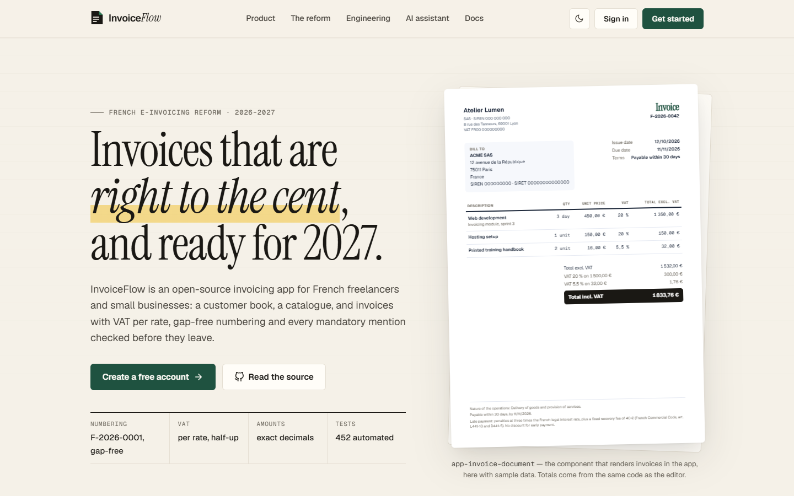
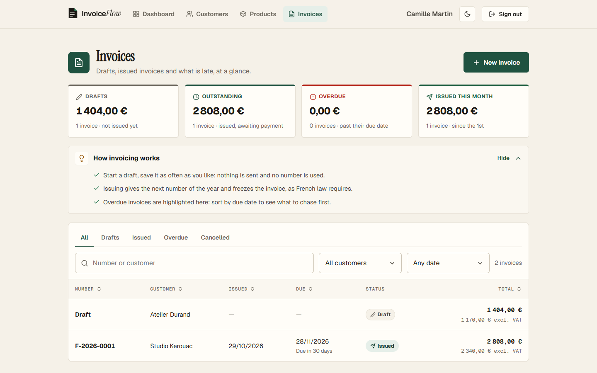
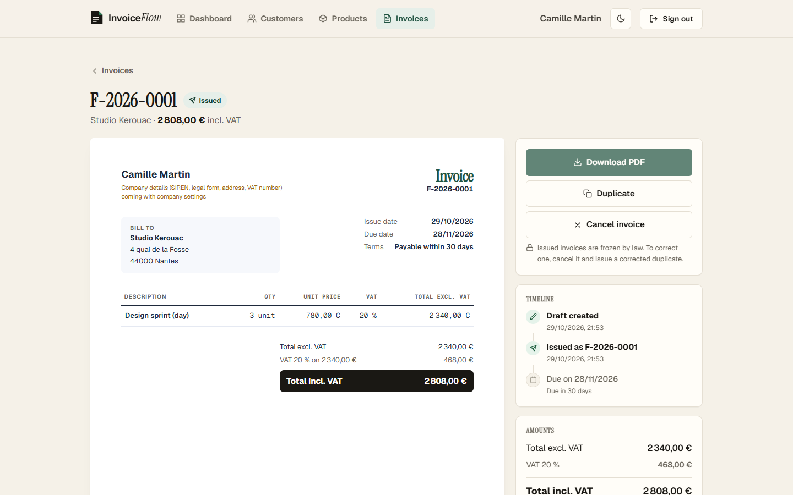
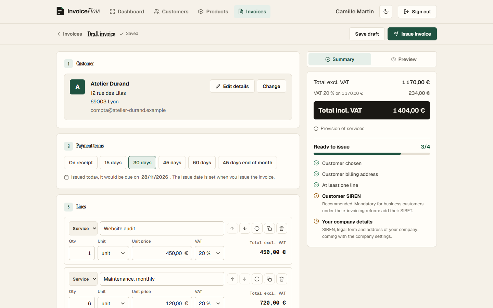
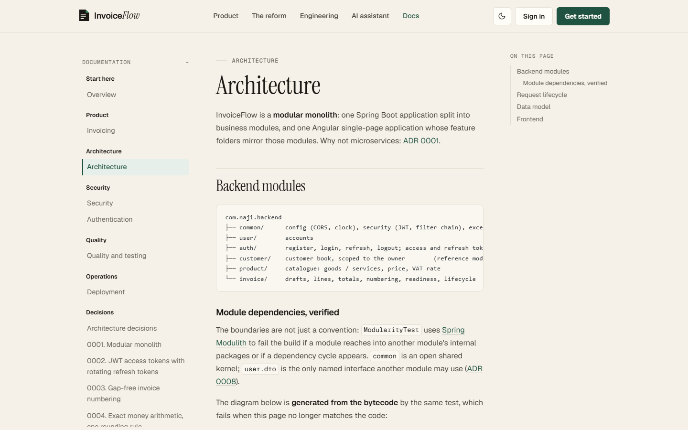
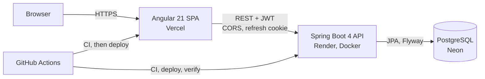

<div align="center">

# InvoiceFlow

**Invoicing for the French e-invoicing reform: compliant invoices, payment tracking and an AI assistant.**

[](https://github.com/BrahimNJ/InvoiceFlow/actions/workflows/backend-ci.yml)
[](https://github.com/BrahimNJ/InvoiceFlow/actions/workflows/frontend-ci.yml)
[](https://github.com/BrahimNJ/InvoiceFlow/actions/workflows/deploy-backend.yml)
[](https://github.com/BrahimNJ/InvoiceFlow/actions/workflows/deploy-frontend.yml)
[](https://github.com/BrahimNJ/InvoiceFlow/actions/workflows/e2e.yml)

<!-- Published by CI on every push to main (branch `badges`), no third-party service: see docs/testing.md -->
[](docs/testing.md)
[](docs/testing.md)
[](docs/testing.md)
[](docs/testing.md)
[](docs/testing.md)
[](docs/testing.md)


[**Live app**](https://invoice-flow-seven-omega.vercel.app) ·
[In-app docs](https://invoice-flow-seven-omega.vercel.app/docs) ·
[API reference](https://invoiceflow-backend-84wn.onrender.com/scalar) ·
[API health](https://invoiceflow-backend-84wn.onrender.com/actuator/health) ·
[Roadmap](PROGRESS.md)

</div>

---

<picture>
  <source media="(prefers-color-scheme: dark)" srcset="docs/screenshots/landing-dark.png">
  
</picture>

## Screenshots

| Invoices at a glance | An issued invoice |
|----------------------|-------------------|
|  |  |

| Invoice editor | In-app documentation |
|----------------|----------------------|
|  |  |

The images are generated by Playwright on the real stack (`npm run screenshots`), never edited by hand.

## Why InvoiceFlow

France is making electronic invoicing mandatory: from **September 2026** every business must be able to receive
e-invoices, and from **September 2027** small and medium businesses must issue them in a structured format
(Factur-X, UBL, CII) through an approved platform.

InvoiceFlow helps small businesses and freelancers get there: customers, products, invoices with VAT computed for
them, PDF and Factur-X output, payment tracking, and an AI assistant that turns a sentence into a draft invoice:

> *"Invoice ACME for 3 days of development at €450 a day, 20% VAT."*

The assistant only proposes structured data: the backend validates it and applies the business rules before anything
is saved.

The project is also a showcase of **professional, AI-assisted software engineering** with Claude Code. Every feature
goes issue → branch → small commits → tests → pull request → human review → CI → automatic deploy
(see [How this project is built](#how-this-project-is-built)).

## Status

| Area | Status |
|------|--------|
| Landing page with live API status | ✅ Live |
| Accounts: sign-up, sign-in, sessions (JWT + rotating refresh tokens) | ✅ Live |
| Secured REST API, CORS, RFC 9457 errors | ✅ Live |
| Customers (per user: list, search, create, edit, delete) | ✅ Live |
| Products & services (per user: goods or service, price excl. VAT, French VAT rate, unit) | ✅ Live |
| Invoices: drafts, VAT per rate, gap-free numbering, readiness checks, issue and cancel, overdue tracking | ✅ Live |
| In-app documentation (`/docs`): architecture, security model, testing, ADRs | ✅ Live |
| API reference (OpenAPI + Scalar), per-IP rate limiting on authentication | ✅ Live |
| Payments | 📋 Planned |
| PDF and Factur-X | 📋 Planned |
| Dashboard (revenue, paid / pending / overdue) | 📋 Planned |
| Role-based access | 📋 Planned |
| AI assistant (natural-language invoices, Q&A) | 📋 Planned |

Detailed tasks, issues and pull requests: [`PROGRESS.md`](PROGRESS.md).

## Quality in numbers

Every figure below is produced by CI on each push, and most of them **fail the build** when they regress.

| Check | Result | Gate |
|-------|--------|------|
| Backend tests (JUnit 5, Spring slices, integration) | **252** passing | `./mvnw verify` |
| Backend coverage (JaCoCo, Lombok excluded) | **97.5 %** lines · **91.7 %** branches | fails under 95 % / 85 % |
| Frontend tests (Vitest, Angular TestBed) | **233** passing | `npm run test:coverage` |
| Frontend coverage (v8) | **96.5 %** lines · **90.4 %** branches | fails under 95 % / 85 % |
| End-to-end (Playwright, desktop and phone) | **20** passing on the production build, real API and PostgreSQL 17 | `e2e.yml` |
| Accessibility (axe-core, WCAG 2.1 AA) | **0** violations on every screen of the journey and on the public pages, light and dark | any violation fails |
| Lighthouse, desktop (`/`, `/docs/overview`, `/login`) | performance **93–100** · accessibility **100** · best practices **100** · SEO **100** | budget in `lighthouserc.json` |
| Module boundaries (Spring Modulith) | no access to another module's internals, no cycle | `ModularityTest` |
| API contract (OpenAPI) | every secured endpoint documented, public ones marked | `ApiDocumentationIntegrationTest` |

Running the real stack pays off: on its first runs axe-core found low-contrast text and keyboard-unreachable
regions, and replaying the journey on PostgreSQL to take the README screenshots exposed a query that H2 accepted
but PostgreSQL rejected, fixed in [#39](https://github.com/BrahimNJ/InvoiceFlow/issues/39) and now guarded by the
end-to-end suite. How each layer is tested and why the tests can be trusted:
[`docs/testing.md`](docs/testing.md).

## Architecture

A **modular monolith**: one Spring Boot application split into business modules, one Angular single-page app.



```text
backend/src/main/java/com/naji/backend/
├── common/        config (CORS, clock), security (JWT, filter chain), exceptions (ProblemDetail), validation
├── user/          accounts: entity, repository, mapper
├── auth/          register, login, refresh, logout; access and refresh tokens
├── customer/      reference CRUD module: entity, repository, service, controller, DTOs, mapper
├── product/       catalogue of goods and services, same layout as customer
└── invoice/       drafts, lines, totals, gap-free numbering, readiness checks, lifecycle, summary

frontend/src/app/
├── core/          auth service, HTTP interceptor, guards, API status, error mapping
├── auth/          sign-in and sign-up pages, password rules, shared form components
├── customers/     customers list and form
├── products/      products catalogue and form
├── invoices/      invoice list with key figures, editor workspace with live preview, detail page
├── docs/          in-app documentation rendered from the docs/ folder at build time
├── dashboard/     first signed-in page
├── home/          landing page sections
└── shared/        logo, icons, forms, money formatting, UI kit (page header, help tip, empty state,
                   confirmation dialog, toasts, autocomplete)

frontend/e2e/      Playwright journey, axe-core checks, README screenshots
```

Each backend module follows the same layout (entity → repository → service → controller, DTO records and a mapper,
never exposing entities), and **Spring Modulith** fails the build if a module reaches into another's internals.
The schema is owned by **Flyway** migrations; Hibernate only validates it. Details:
[`docs/architecture.md`](docs/architecture.md).

## Tech stack

| Layer | Technologies |
|-------|--------------|
| Frontend | Angular 21 (standalone components, signals, zoneless), TypeScript 5.9, RxJS, typed reactive forms, plain CSS design tokens, Vitest |
| Backend | Java 21, Spring Boot 4.1, Spring Security 7 (OAuth2 resource server, Nimbus JOSE), Spring Data JPA, Bean Validation, Lombok, Spring Modulith, springdoc-openapi + Scalar, Bucket4j |
| Data | PostgreSQL 17 (Neon in production, Docker locally), Flyway, H2 in PostgreSQL mode for tests |
| Quality | JUnit 5, Mockito, AssertJ, JaCoCo; Vitest with v8 coverage; Playwright, axe-core, Lighthouse CI |
| Delivery | GitHub Actions (CI, end-to-end, deploy, post-deploy verification), Docker, Render, Vercel |
| AI tooling | Claude Code (development workflow); LLM API planned for the in-app assistant |

## Security

Authentication is designed for a browser app talking to an API on another site. Full write-up with sequence diagrams:
[`docs/authentication.md`](docs/authentication.md).

- **Short-lived JWT access tokens** (15 min, HS256), kept in memory only, verified by Spring's resource server
  (signature, algorithm, issuer, expiry).
- **Opaque refresh tokens** in an `HttpOnly; Secure` cookie limited to `/api/auth`, stored hashed, **rotated on every
  use**, with **reuse detection** that revokes every session (RFC 9700).
- CSRF defense on cookie endpoints, strict CORS allow-list, BCrypt passwords with a shared password policy,
  account lockout after 5 failures, no account enumeration (same message, same timing), safe redirects.
- **Per-client rate limit** on sign-in, sign-up and refresh (Bucket4j, 10 requests a minute, IPv6 keyed by /64):
  `429` problem detail with `Retry-After`, so one client cannot spray passwords across many accounts.
- Threat model, controls and open items: [`docs/security.md`](docs/security.md).
- Every endpoint requires authentication except sign-up/sign-in, health and deployed-version info.
  Errors follow RFC 9457 `ProblemDetail`.

## API overview

| Method | Path | Auth | Description |
|--------|------|------|-------------|
| `POST` | `/api/auth/register` | — | Create an account, start a session |
| `POST` | `/api/auth/login` | — | Start a session |
| `POST` | `/api/auth/refresh` | refresh cookie | New access token, rotated refresh token |
| `POST` | `/api/auth/logout` | refresh cookie | End the session |
| `GET` | `/api/auth/me` | bearer | Current user |
| `GET` | `/api/customers?search=&page=&size=` | bearer | The user's customers, paginated (≤ 100), searched by name or email |
| `GET` `POST` `PUT` `DELETE` | `/api/customers[/{id}]` | bearer | Customer CRUD, scoped to the owner (another user's id → `404`) |
| `GET` | `/api/products?search=&type=&page=&size=` | bearer | The user's products, paginated (≤ 100), searched by name or description, `type` = `GOODS` or `SERVICE` |
| `GET` `POST` `PUT` `DELETE` | `/api/products[/{id}]` | bearer | Product CRUD, scoped to the owner; VAT rate must be 20, 10, 5.5, 2.1 or 0 |
| `GET` | `/api/invoices?search=&status=&customerId=&issuedFrom=&issuedTo=&sort=&direction=&page=&size=` | bearer | The user's invoices; `status` includes `OVERDUE` |
| `GET` | `/api/invoices/summary` | bearer | Drafts, outstanding, overdue and issued this month |
| `GET` `POST` `PUT` `DELETE` | `/api/invoices[/{id}]` | bearer | Draft CRUD (issued invoices → `409`) |
| `POST` | `/api/invoices/{id}/issue` · `/cancel` · `/duplicate` | bearer | Lifecycle; issue → `422` with the missing mentions. See [`docs/invoicing.md`](docs/invoicing.md) |
| `GET` | `/actuator/health` | — | Liveness, includes the database |
| `GET` | `/actuator/info` | — | Deployed commit |

## Getting started

**Prerequisites:** Java 21, Node.js 22, Docker.

```bash
git clone https://github.com/BrahimNJ/InvoiceFlow.git && cd InvoiceFlow

# 1. PostgreSQL (data kept in the postgres-data volume)
docker compose up -d

# 2. Backend on http://localhost:8080 (dev profile; Flyway creates the schema)
cd backend && ./mvnw spring-boot:run

# 3. Frontend on http://localhost:4200 (in another terminal)
cd frontend && npm install && npm start
```

Open http://localhost:4200/register to create an account. The defaults work out of the box; to change ports or
credentials, copy `.env.example` to `.env` (git-ignored) and export what you need.

### Configuration

| Variable | Used by | Default (dev) | Production |
|----------|---------|---------------|------------|
| `DB_URL`, `DB_USERNAME`, `DB_PASSWORD` | backend | local Docker PostgreSQL | Neon, required |
| `JWT_SECRET` | backend | dev-only key | required, ≥ 32 bytes (generated by Render) |
| `CORS_ALLOWED_ORIGINS` | backend | `http://localhost:4200` | Vercel URL |
| `REFRESH_COOKIE_SAME_SITE` | backend | `Strict` | `None` (frontend and API on different sites) |
| `apiUrl` in `frontend/src/environments/` | frontend | `http://localhost:8080` | Render URL |

Spring profiles: `dev` (default, local PostgreSQL), `test` (H2, used by the test suite and CI), `prod` (everything
from the environment, fails fast when a secret is missing).

## Tests

```bash
cd backend  && ./mvnw verify                 # 252 tests, modularity, coverage floor
cd frontend && npm run test:coverage         # 233 tests, coverage floor
```

End-to-end tests, the Lighthouse budget and the README screenshots run on the real stack (PostgreSQL and the API
started as in [Getting started](#getting-started)):

```bash
cd frontend && npm run build:e2e             # production build that calls localhost:8080
npx playwright test                          # 20 tests with axe-core, desktop and phone
npx --yes @lhci/cli@0.15.1 autorun           # Lighthouse budget
npm run screenshots                          # regenerates docs/screenshots
```

| Layer | What is covered |
|-------|-----------------|
| Backend unit | Services with Mockito (business rules, lockout, token rotation and reuse detection), invoice totals, due dates and readiness |
| Backend slice | `@WebMvcTest` controllers with the real security chain, `@DataJpaTest` repositories on the Flyway schema, real JWTs (expired, forged, wrong issuer) |
| Backend end to end | Full authentication flow and invoice lifecycle through the real stack, concurrent invoice numbering with committed transactions |
| Frontend | Services, interceptor (refresh and retry), guards, validators, components and pages (Vitest + Angular TestBed) |
| End to end | Sign-up to issued invoice in Chrome against the real API and PostgreSQL, key figures and filters, axe-core on every screen |
| Performance | Lighthouse scores and transferred bytes per public page |

The same commands run in CI on every push and pull request, and the figures feed the badges at the top of this page.

## Deployment

Every merge on `main` with green CI is deployed automatically, and the backend deploy is **verified**: the workflow
waits until production reports the new commit, then smoke-tests health, authentication and CORS.

| Part | Host | URL |
|------|------|-----|
| Frontend | Vercel | https://invoice-flow-seven-omega.vercel.app |
| Backend | Render (Docker, free plan: first request after idle takes about a minute) | https://invoiceflow-backend-84wn.onrender.com/actuator/health |
| Database | Neon (PostgreSQL) | private |

Pipeline, secrets, platform settings, troubleshooting and rollback: [`docs/deployment.md`](docs/deployment.md).

## How this project is built

InvoiceFlow is developed with **Claude Code** as a coding agent, under rules that keep the human in charge:

| Practice | In this repository |
|----------|--------------------|
| Explicit context | [`CLAUDE.md`](CLAUDE.md) (rules, always loaded), [`PROGRESS.md`](PROGRESS.md) (state and next task) |
| Traceability | One GitHub issue per feature, branch `<issue>-<type>/<name>`, conventional commits with `Refs #n` |
| Small, verified steps | One commit per concern; each compiles and passes the tests; real results reported |
| Independent review | A read-only `reviewer` subagent reviews every non-trivial diff before it is committed; its findings are fixed or listed in the pull request |
| Proof, not claims | Every pull request reports the real test results, and a fix ships with a test shown to fail without it |
| Human review | The agent never merges; pull requests are reviewed before merge |
| Least privilege | [`.claude/settings.json`](.claude/settings.json) allows safe commands, asks for push/PR, denies destructive commands and secrets |

The full workflow and its rationale: [`docs/claude-code/best-practices.md`](docs/claude-code/best-practices.md);
subagents, skills and hooks: [`docs/claude-code/agents.md`](docs/claude-code/agents.md).

## Documentation

The same Markdown files are rendered in the app at [`/docs`](https://invoice-flow-seven-omega.vercel.app/docs).

| Document | Content |
|----------|---------|
| [`docs/overview.md`](docs/overview.md) | What the product does today and the engineering worth a look |
| [`docs/invoicing.md`](docs/invoicing.md) | Business rules: totals, VAT, numbering, mandatory mentions, lifecycle |
| [`docs/architecture.md`](docs/architecture.md) | Modules (verified by Spring Modulith), request lifecycle, data model |
| [`docs/security.md`](docs/security.md) | Threat model, controls, open items |
| [`docs/authentication.md`](docs/authentication.md) | Tokens, flows, security decisions, configuration |
| [`docs/testing.md`](docs/testing.md) | Test pyramid, coverage, end-to-end, accessibility, Lighthouse, CI |
| [`docs/deployment.md`](docs/deployment.md) | CI/CD pipeline, secrets, verification, troubleshooting |
| [`docs/adr/`](docs/adr/) | Architecture decision records (MADR) |
| [`docs/claude-code/best-practices.md`](docs/claude-code/best-practices.md) | AI-assisted development workflow |
| [`PROGRESS.md`](PROGRESS.md) | Roadmap, status, changelog |

## Author

**Brahim Naji** · [GitHub](https://github.com/BrahimNJ)
