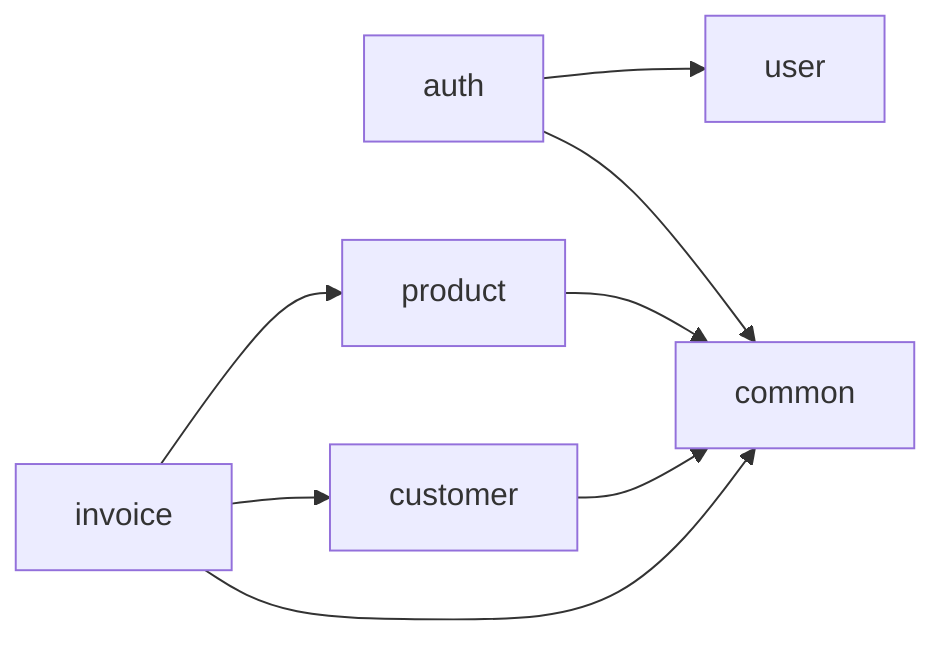
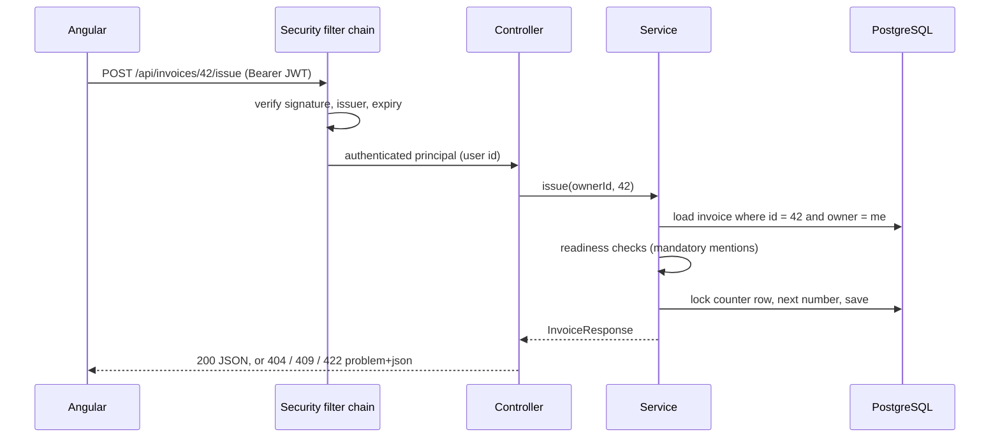
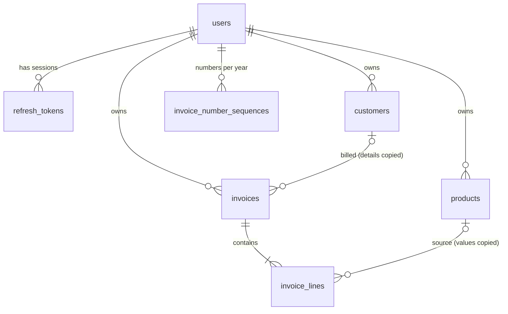

# Architecture

InvoiceFlow is a **modular monolith**: one Spring Boot application split into business modules, and one Angular
single-page application whose feature folders mirror those modules. Why not microservices:
[ADR 0001](adr/0001-modular-monolith.md).

## Backend modules

```text
com.naji.backend
├── common/      config (CORS, clock), security (JWT, filter chain), exception (ProblemDetail), validation, web
├── user/        accounts
├── auth/        register, login, refresh, logout; access and refresh tokens
├── customer/    customer book, scoped to the owner        (reference module)
├── product/     catalogue: goods / services, price, VAT rate
└── invoice/     drafts, lines, totals, numbering, readiness, lifecycle
```

### Module dependencies, verified

The boundaries are not just a convention: `ModularityTest` uses [Spring Modulith](https://spring.io/projects/spring-modulith)
to fail the build if a module reaches into another module's internal packages or if a dependency cycle appears.
`common` is an open shared kernel; `user.dto` is the only named interface another module may use
([ADR 0008](adr/0008-verified-module-boundaries.md)).

The diagram below is **generated from the bytecode** by the same test, which fails when this page no longer matches
the code:

<!-- modules:start (generated by ModularityTest, do not edit by hand) -->

<!-- modules:end -->

Each module owns its entity, repository, service, controller, mapper and `dto/` records. Rules every module follows:

| Rule | Why |
|------|-----|
| Controllers never expose JPA entities: request / response records + mapper | The API contract does not change when the schema does; no lazy-loading surprises in JSON |
| Every query takes the owner id | Tenant isolation cannot be forgotten in one endpoint ([Security](security.md)) |
| Business rules live in services and dedicated classes (`InvoiceCalculator`, `InvoiceReadiness`, `InvoiceNumberGenerator`) | Unit-testable without Spring or a database |
| Errors are exceptions mapped once by `GlobalExceptionHandler` to RFC 9457 problem details | One error format for the whole API ([ADR 0005](adr/0005-problem-details.md)) |
| Time comes from an injected `Clock` | Due dates and overdue status are testable on fixed dates |

## Request lifecycle



## Data model



- Every business table carries `owner_id` with `ON DELETE CASCADE` to its user.
- An invoice **copies** the customer's details and each line copies the product's label, price and VAT rate: an
  issued invoice must never change when the customer or the catalogue is edited later (`ON DELETE SET NULL` on the
  links).
- `invoices (owner_id, number)` is unique; `invoice_number_sequences` holds one counter per owner and fiscal year.
- Six Flyway migrations (`V1` to `V6`) build the schema; the application never alters it at runtime
  (`ddl-auto=validate`).

## Frontend

```text
frontend/src/app
├── core/        auth (service, interceptor, guards), http (problem details, pages), theme
├── shared/      UI kit: page header, empty state, help tips, confirm dialog, toasts, icons, money formatting
├── home/        public landing page
├── docs/        this documentation
├── customers/ products/ invoices/   one folder per business feature, one sub-folder per screen
└── auth/        sign-in and sign-up pages
```

| Choice | Why |
|--------|-----|
| Standalone components, `OnPush`, signals | Explicit data flow, change detection only where state changes |
| Lazy routes per screen | Visitors download only the page they open |
| Access token in a signal (memory), refresh through an interceptor | Nothing readable by injected scripts survives a reload ([Authentication](authentication.md)) |
| Problem details mapped to form fields | Server validation messages land next to the right input |
| Design tokens in CSS custom properties, derived with `color-mix()` | One identity, a dark theme by redefining tokens ([ADR 0006](adr/0006-visual-identity-and-self-hosted-fonts.md)) |
| Documentation rendered at build time | No Markdown or highlighting library shipped to the browser ([ADR 0007](adr/0007-docs-rendered-at-build-time.md)) |
