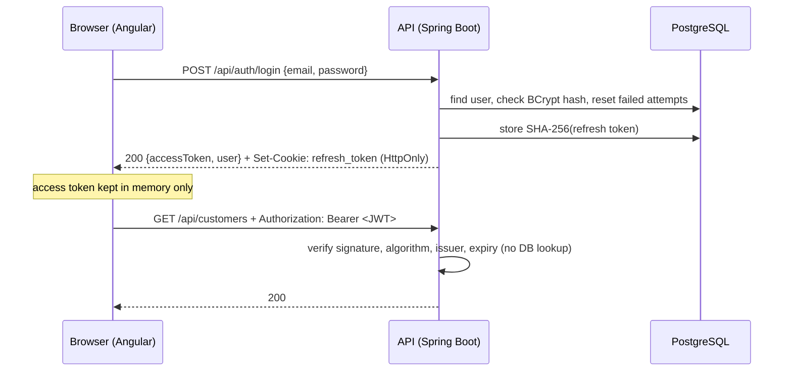
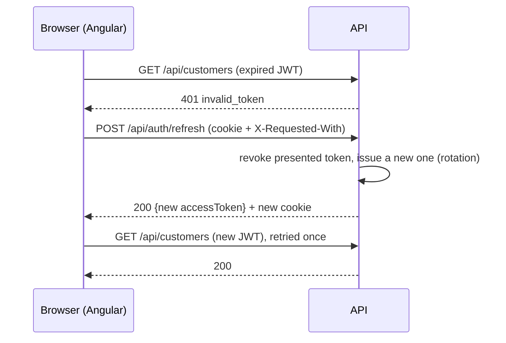
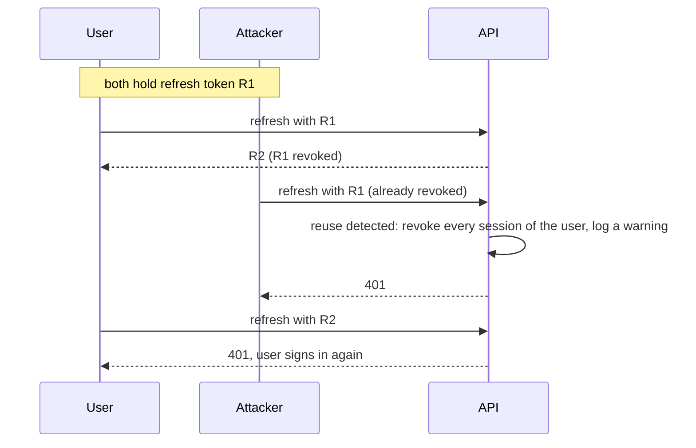

# Authentication

InvoiceFlow uses **stateless JWT access tokens** plus **rotating refresh tokens in an HttpOnly cookie**.
Every API endpoint requires a signed-in user, except the ones listed below.
Introduced by #19.

## Overview

| Token | Format | Lifetime | Stored by the client | Stored by the server | Sent as |
|-------|--------|----------|----------------------|----------------------|---------|
| Access token | JWT, HS256 | 15 min | In memory only (Angular signal) | Nothing (stateless) | `Authorization: Bearer …` |
| Refresh token | Opaque random 256-bit value | 7 days, renewed on each use | `HttpOnly` cookie, path `/api/auth` | SHA-256 hash only (`refresh_tokens`) | Cookie, on `/api/auth/*` only |

Why two tokens: a JWT is checked without a database lookup but cannot be revoked, so it lives 15 minutes.
The refresh token can be revoked (sign-out, theft) and is never readable by JavaScript.

## Endpoints

| Method | Path | Auth | Success | Errors |
|--------|------|------|---------|--------|
| `POST` | `/api/auth/register` | none | `201` + body + cookie | `400` validation, `409` email taken |
| `POST` | `/api/auth/login` | none | `200` + body + cookie | `400`, `401` invalid credentials, `429` account locked |
| `POST` | `/api/auth/refresh` | cookie + `X-Requested-With` | `200` + body + new cookie | `401`, `403` header missing |
| `POST` | `/api/auth/logout` | cookie + `X-Requested-With` | `204`, cookie cleared | `403` header missing |
| `GET` | `/api/auth/me` | bearer | `200` user | `401` |
| any | `/api/**` (customers, …) | bearer | | `401` |

Public without a token: the four `POST /api/auth/*` above, `/actuator/health`, `/error`.

Success body (`register`, `login`, `refresh`):

```json
{
  "accessToken": "eyJhbGciOiJIUzI1NiJ9…",
  "tokenType": "Bearer",
  "expiresIn": 900,
  "user": { "id": 1, "email": "jane@acme.fr", "firstName": "Jane", "lastName": "Doe", "role": "USER", "createdAt": "…" }
}
```

Every error is an RFC 9457 `ProblemDetail` (`application/problem+json`), like the rest of the API; 401 responses
also carry an RFC 6750 `WWW-Authenticate: Bearer` challenge (`error="invalid_token"` for a bad token).

Access token claims: `iss` (`invoiceflow`), `sub` (user id), `iat`, `exp`, `jti`, `email`, `roles` (`["USER"]`).

## Flows

### Sign-in and API calls



### Expired access token (interceptor)



Concurrent 401s share **one** refresh request: the refresh token is single-use, a second parallel refresh would look
like a replay. If the refresh fails, the session ends and the user is sent to `/login?returnUrl=…`.

### Page reload

The access token is lost on reload (memory only). On startup the app calls `/api/auth/refresh` once, **only if this
browser signed in before** (a non-secret `invoiceflow.has-session` flag in `localStorage`), without blocking the first
render. Guards wait for this restore before deciding.

### Stolen refresh token



This is the reuse detection recommended by RFC 9700 (OAuth 2.0 Security BCP, 4.14.2). A token revoked by sign-out
is treated the same way: harmless, since the browser deletes the cookie when signing out.

## Security decisions

| Threat | Defense | Where |
|--------|---------|-------|
| XSS stealing tokens | Access token in memory, refresh token in an `HttpOnly` cookie | `AuthService` (Angular), `RefreshTokenCookies` |
| CSRF on cookie endpoints | `X-Requested-With` header required on refresh/logout: a cross-site form cannot send it, a cross-site script triggers a CORS preflight that only allowed origins pass. Cookie limited to `/api/auth`. Other endpoints use the bearer header, never cookies | `AuthController`, `CorsConfig` |
| Forged or tampered JWT | HS256 only (no `alg=none`, no algorithm confusion), signature, issuer and expiry checked by Spring's resource server | `SecurityConfig` |
| Weak signing key | `JWT_SECRET` ≥ 32 bytes, checked at startup; no default in `prod`, generated by Render | `JwtProperties`, `render.yaml` |
| Database leak | BCrypt password hashes (algorithm-prefixed, re-encoded on login if the default changes); refresh tokens stored as SHA-256 hashes | `SecurityConfig`, `RefreshTokenService` |
| Refresh token theft | Rotation on every use, reuse detection revokes all sessions | `RefreshTokenService` |
| Brute force | 5 failed attempts lock the account for 15 min (`429`) | `AuthService` |
| Account enumeration | Same `401 Invalid email or password` for unknown email and wrong password, with a dummy hash check so timing is the same (checked: ~140 ms both) | `AuthService` |
| Weak passwords | 12+ chars, lower, upper, digit; ≤ 72 UTF-8 bytes (BCrypt limit). Same rules on both sides | `@StrongPassword`, `password.validators.ts` |
| Open redirect after sign-in | `returnUrl` must be a same-site path | `safeReturnUrl` |
| Secrets in logs | `toString()` of passwords, tokens and `JwtProperties` hides the values | DTOs, `IssuedToken`, `JwtProperties` |
| Lost revocation on error | Auth transactions commit even when they throw (`noRollbackFor`), so failed attempts and revocations are kept. Verified by mutation in `AuthFlowIntegrationTest` | `AuthService`, `RefreshTokenService` |

Spring Security also sends `Cache-Control: no-store`, `X-Content-Type-Options: nosniff` and `X-Frame-Options: DENY`.

## Configuration

| Property | Env var | Default | Notes |
|----------|---------|---------|-------|
| `app.security.jwt.secret` | `JWT_SECRET` | dev/test only | Required in prod, ≥ 32 bytes (`openssl rand -base64 32`) |
| `app.security.jwt.issuer` | | `invoiceflow` | |
| `app.security.jwt.access-token-ttl` | | `15m` | |
| `app.security.refresh-token.ttl` | | `7d` | Sliding: each refresh starts a new period |
| `app.security.refresh-cookie.secure` | | `true` (`false` in dev, plain HTTP) | |
| `app.security.refresh-cookie.same-site` | `REFRESH_COOKIE_SAME_SITE` (prod) | `Strict`, `None` in prod | `None` requires `secure` (checked at startup) |
| `app.cors.allowed-origins` | `CORS_ALLOWED_ORIGINS` | `http://localhost:4200` | Credentials are allowed for these origins only |

## Code map

| Backend | Role |
|---------|------|
| `common/security/SecurityConfig` | Filter chain, JWT encoder/decoder, roles mapping, password encoder |
| `common/security/JwtProperties` | Validated access token settings |
| `user/User`, `UserRepository`, `UserMapper` | Accounts (Flyway `V2`) |
| `auth/AuthController` | REST endpoints, cookie handling, CSRF header check |
| `auth/AuthService` | Register, login (lockout, timing), refresh, logout, current user |
| `auth/AccessTokenService` | Signs access tokens |
| `auth/RefreshTokenService`, `RefreshToken` | Opaque tokens, rotation, reuse detection (Flyway `V3`) |
| `common/validation/StrongPassword` | Password policy |
| `common/exception/GlobalExceptionHandler` | 401 / 403 / 409 / 429 as `ProblemDetail` |

| Frontend | Role |
|----------|------|
| `core/auth/auth.service.ts` | Session state (signals), login/register/refresh/logout/restore |
| `core/auth/auth.interceptor.ts` | Bearer token, cookie + CSRF header, refresh-and-retry on 401 |
| `core/auth/auth.guards.ts` | `authGuard`, `guestGuard`, `safeReturnUrl` |
| `auth/login`, `auth/register` | Pages |
| `auth/shared/*` | Layout, password rules and strength, show/hide toggle, submit button, form helpers |
| `dashboard/dashboard.ts` | First protected page (placeholder) |

## Tests

| Layer | Tests |
|-------|-------|
| Backend unit | `AuthServiceTest`, `RefreshTokenServiceTest`, `AccessTokenServiceTest`, `StrongPasswordValidatorTest`, properties tests |
| Backend slice | `AuthControllerTest`, `JwtAuthenticationTest` (real tokens: expired, wrong issuer, wrong key, malformed), repositories on the Flyway schema |
| Backend end to end | `AuthFlowIntegrationTest`: register → protected API → me → refresh → replay detection → login → logout; lockout; enumeration |
| Frontend | Service, interceptor (retry, single refresh, no loop), guards, validators, components, login/register/dashboard pages |

## Known limits and follow-ups

- **Safari and third-party cookies**: in prod the frontend (Vercel) and the API (Render) are different sites, so the
  refresh cookie is a third-party cookie. Browsers that block them do not send it: the session lasts 15 minutes and
  does not survive a reload. Fix: serve the API under the frontend domain (Vercel rewrite `/api/*` → Render), then
  set `REFRESH_COOKIE_SAME_SITE=Strict`.
- Role-based access per endpoint (task 6.2), per-user data ownership.
- Email verification, password reset, "sign out everywhere" endpoint.
- Rate limiting by IP (the lockout is per account) and cleanup of expired refresh tokens.
