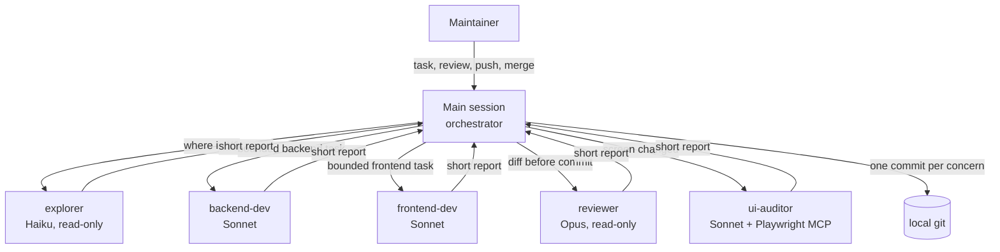

# Claude Code — agents, skills and hooks

How InvoiceFlow is built with an **orchestrated team of specialized agents** instead of one long generalist session.
The principles in [`best-practices.md`](best-practices.md) still apply: the human owns every decision that leaves the machine.

---

## 1. Orchestration model



The main session plans, delegates, integrates and commits. Agents never touch git state: one place commits, so history
stays coherent and every commit is reviewable.

| Agent | Model | Tools | Use it for | Why this model |
|-------|-------|-------|------------|----------------|
| `explorer` | Haiku | Read, Grep, Glob | Locating code and conventions across many files | Search is cheap work; returns paths, not file dumps |
| `backend-dev` | Sonnet | Read, Grep, Glob, Edit, Write, Bash | A bounded backend layer or endpoint, with tests | Strong coding at a moderate cost |
| `frontend-dev` | Sonnet | Read, Grep, Glob, Edit, Write, Bash | A bounded Angular screen or service, with specs | Same |
| `reviewer` | Opus | Read, Grep, Glob, Bash | Independent review of the diff before commit / PR | Finding subtle bugs is where the strongest model pays off |
| `ui-auditor` | Sonnet | Read, Grep, Glob, Bash, Playwright browser tools | Real-browser checks: phone/desktop screenshots, console, keyboard, accessibility | Unit tests cannot see a broken layout |

Definitions live in [`.claude/agents/`](../../.claude/agents/). Each one states its scope, its forbidden actions
(no git, no out-of-scope files) and the exact shape of its final report.

Be precise about what is enforced: tool lists are enforced by Claude Code, but agents that have Bash *could* run
git; "never commit" and "read-only use of Bash" are instructions in the agent prompt. The `guard-commit` hook still
applies to them, and every change is reviewed before it is committed.

### When to delegate, when not to

| Delegate | Keep in the main session |
|----------|--------------------------|
| Searches across many files where only the conclusion matters | Reading one or two files you already know |
| Independent pieces that can run in parallel (backend layer + frontend screen) | Small edits, a few lines |
| A second opinion on a diff (the reviewer has no stake in the code it reviews) | Anything that depends on decisions taken in the conversation |
| Browser checks that produce screenshots and long console logs | Committing, `PROGRESS.md`, talking to the user |

---

## 2. Skills (repeatable procedures)

Project skills in [`.claude/skills/`](../../.claude/skills/) turn the workflow into commands:

| Skill | What it does |
|-------|--------------|
| `/new-module <name> [issue]` | Scaffolds a module layer by layer (migration → entity → DTO/mapper → service → controller → UI), one commit per layer, review at the end |
| `/commit` | One conventional commit: coherence check, sensitive-file check, tests for what changed, `Refs #n` from the branch |
| `/progress` | Updates `PROGRESS.md` from the real state of git and pull requests |

---

## 3. Hooks (deterministic guard rails)

Rules in `CLAUDE.md` are instructions; hooks are **enforced by the harness**, whatever the model decides.
Scripts live in [`.claude/hooks/`](../../.claude/hooks/), written in Node so they behave the same on every OS.

| Hook | Event | Effect |
|------|-------|--------|
| `guard-commit.mjs` | `PreToolUse` on Bash | Blocks `git add` / `git commit` of `.env*`, keys, IDE metadata, personal Claude settings, and blanket `git add -A` |
| `format-frontend.mjs` | `PostToolUse` on Edit/Write | Formats the edited frontend file with the project's Prettier |

`guard-commit` does not pattern-match the command text: it asks git which paths each `git add` would stage
(`git add --dry-run`) and checks those, plus the index when a commit runs. Directories, globs, quoted paths and
`git -C` are therefore resolved exactly as git resolves them, and commit messages never trigger it.
Its behaviour is covered by tests against a throwaway repository: `node --test .claude/hooks/*.test.mjs`.

To activate them, the maintainer adds this block to `.claude/settings.json` (team-wide, versioned):

```json
"hooks": {
  "PreToolUse": [
    { "matcher": "Bash", "hooks": [{ "type": "command", "command": "node \"$CLAUDE_PROJECT_DIR/.claude/hooks/guard-commit.mjs\"" }] }
  ],
  "PostToolUse": [
    { "matcher": "Edit|Write", "hooks": [{ "type": "command", "command": "node \"$CLAUDE_PROJECT_DIR/.claude/hooks/format-frontend.mjs\"" }] }
  ]
}
```

The agent is not allowed to register hooks itself: changing its own guard rails is the maintainer's decision.

---

## 4. Parallel work with worktrees

Independent lots run in separate git worktrees, one branch each, so two agents never edit the same working tree:

```bash
git worktree add ../InvoiceFlow-lot6 33-chore/claude-workflow
```

First real use: while `frontend-dev` restyled the signed-in screens on `33-feat/visual-identity` in the main working
tree, the orchestrator fixed the reviewer's findings on this branch in `../InvoiceFlow-lot6`, with no branch switching
and no risk of mixing the two changes.

Each worktree gets its own Claude Code session (or an agent started with `isolation: worktree`). Integration happens
through pull requests, exactly as with human contributors.

---

## 5. Context and token strategy

Multi-agent work is **not** automatically cheaper. Each agent starts with an empty context and re-reads what it needs,
so the total token count can go up. What it buys:

- **A clean main context**: long searches, test logs and screenshots stay inside the agent; the orchestrator gets a
  ten-line report. Long sessions stay accurate instead of drowning in noise.
- **Cheaper models where they suffice**: Haiku for search, Sonnet for implementation, Opus only for review.
- **Parallelism**: independent lots progress at the same time.

What actually reduces tokens:

| Practice | Effect |
|----------|--------|
| Directory-scoped `backend/CLAUDE.md` and `frontend/CLAUDE.md` | Stack rules load only when working in that directory |
| Short root `CLAUDE.md`, long explanations in `docs/` | Smaller fixed cost on every request |
| `explorer` returns `path:line` lists | The main session never loads whole files to find one function |
| Agents report in a fixed, short format | Predictable, small results |
| One session per lot, `/clear` between lots | No stale history re-sent on every message |
| Skills for repeated procedures | A procedure is loaded only when invoked, not kept in `CLAUDE.md` |

---

## 6. MCP servers

| Server | Config | Purpose |
|--------|--------|---------|
| Playwright (`@playwright/mcp`, pinned) | [`.mcp.json`](../../.mcp.json) | Real-browser checks by `ui-auditor` |
| Angular CLI (`ng mcp`) | [`frontend/.vscode/mcp.json`](../../frontend/.vscode/mcp.json) | Angular best practices and docs in the editor |

Project MCP servers require the maintainer's approval the first time Claude Code starts in the repository.
