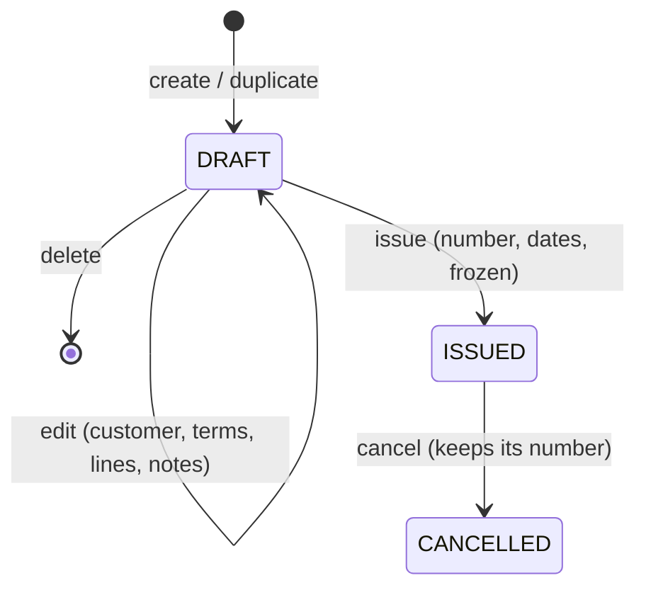

# Invoicing

How InvoiceFlow writes, numbers and follows invoices, and why the screens look the way they do.
Code: backend `com.naji.backend.invoice`, frontend `src/app/invoices`. Issue #31.

## Lifecycle

| Status | Edit | Delete | Issue | Cancel | Duplicate |
|--------|------|--------|-------|--------|-----------|
| `DRAFT` | yes | yes | if ready | `409` | yes |
| `ISSUED` | `409` | `409` | `409` | yes | yes |
| `CANCELLED` | `409` | `409` | `409` | `409` | yes |

**Overdue** is not a status: an issued invoice is overdue the day after its due date (Paris time). The list derives it
on each request, so nothing needs a nightly job.

## Business rules

### Totals

All amounts are `BigDecimal` euros (frontend: integer cents and `BigInt`, so the live preview never shows binary
rounding errors).

- Line total excluding VAT = quantity (≤ 3 decimals) × unit price (≤ 2 decimals), rounded **half up** to the cent.
- VAT is computed **once per rate**, on the sum of the line totals at that rate, then rounded. Rounding every line
  would let cents drift on long invoices (3 × round(0.005) = 0.03, but round(0.015) = 0.02).
- Total including VAT = subtotal + VAT. The response carries the breakdown per rate (base and amount), printed on the
  invoice.

### Numbering

`F-<year>-<0001>`, per user and per year of the issue date. French law requires a continuous sequence without gaps.

- `invoice_number_sequences(owner_id, fiscal_year, last_value)` holds the last number. Issuing runs, in one
  transaction: insert the row if missing (`ON CONFLICT DO NOTHING`), increment it (the row is now locked), read it.
- A concurrent issue waits on that lock; a rolled-back issue gives its number back. Tested with concurrent
  transactions (`InvoiceNumberGeneratorTest`).
- The invoice row itself is locked (`SELECT … FOR UPDATE`) before issuing or cancelling, so a double click cannot
  issue the same draft twice and burn a number.
- A cancelled invoice keeps its number.

### Dates

The issue date is set when the invoice is issued (today in Paris), never typed: numbers and dates then always grow
together. The due date follows the payment terms: on receipt, 15, 30, 45 or 60 days, or 45 days end of month
(45 days, then the end of that month), the terms allowed by French law.

### Customer details

The customer's billing details are copied onto the invoice on every draft save, refreshed once more when it is issued,
then frozen. Editing or deleting the customer later never changes an issued invoice; references to deleted customers
and products become `NULL`.

### Readiness checks

Issuing is refused with **422** and the list of `missing` checks when a required mention is absent:

| Check | Level | Why |
|-------|-------|-----|
| `CUSTOMER` | required | The invoice must name the customer |
| `CUSTOMER_ADDRESS` | required | Customer billing address is a mandatory mention |
| `LINES` | required | Something must be billed |
| `CUSTOMER_SIREN` | recommended | Mandatory for business customers under the e-invoicing reform; customers do not say yet whether they are a business |

The **operation nature** (goods, services or both), another mention required by the reform, is derived from the
line types. The seller's own mentions (SIREN, legal form, address, VAT number) need the company settings (task 5.1):
the checklist shows them as pending without blocking.

## Screens

The design answers recurring complaints found in reviews of French invoicing tools and invoicing UX write-ups:

| Complaint | Answer |
|-----------|--------|
| Too many clicks and screen switches to write an invoice | One workspace: customer, terms, lines and notes on one page; create a customer in a drawer without leaving it |
| Invoices sent without a mandatory mention | A live readiness checklist; Issue stays disabled until the required checks pass, and the backend checks again |
| Issued invoices cannot be changed, and nothing explains why | The detail page says it, and offers Duplicate and Cancel |
| Late invoices are hard to spot, filter by customer | Key figure tiles, an Overdue tab, a customer filter, sorting by due date, "9 days late" on each row |
| The preview and the PDF disagree | One document component renders the editor preview and the detail page (the PDF of task 4.1 will reuse its model) |

- **List** `/invoices`: key figures (drafts, outstanding, overdue, issued this month) that filter the list, status
  tabs, search by number or customer, customer and period filters, sortable columns, relative due dates. Cards on
  phones.
- **Editor** `/invoices/new`, `/invoices/:id/edit`: customer autocomplete with its billing card, payment terms with the
  due date if issued today, a line grid edited in place (catalogue picker, free lines, Enter to move or add,
  duplicate, reorder, details), notes. The side panel shows the totals with VAT bases, the checklist and the A4
  preview. On phones a bottom bar keeps the total in sight and opens the preview full screen. Leaving with unsaved
  changes asks first.
- **Detail** `/invoices/:id`: the A4 document, with actions by status, a status timeline, the amounts and the customer.

## API

| Method | Path | Description |
|--------|------|-------------|
| `GET` | `/api/invoices?search=&status=&customerId=&issuedFrom=&issuedTo=&sort=&direction=&page=&size=` | List; `status` = `DRAFT`, `ISSUED` (overdue included), `OVERDUE`, `CANCELLED`; `sort` = `CREATED_AT` (default, newest first), `NUMBER`, `CUSTOMER`, `ISSUE_DATE`, `DUE_DATE`, `TOTAL` |
| `GET` | `/api/invoices/summary` | Count and total of drafts, outstanding, overdue and issued this month |
| `GET` | `/api/invoices/{id}` | Full invoice: lines, VAT breakdown, checks, operation nature, `overdue` |
| `POST` `PUT` | `/api/invoices[/{id}]` | Create or rewrite a draft; validation errors per line (`lines[1].quantity`) |
| `DELETE` | `/api/invoices/{id}` | Delete a draft |
| `POST` | `/api/invoices/{id}/issue` | Issue a draft (`422` with `missing` when not ready) |
| `POST` | `/api/invoices/{id}/cancel` | Cancel an issued invoice |
| `POST` | `/api/invoices/{id}/duplicate` | New draft from any invoice (`201`) |

Every call is scoped to the owner of the access token: another user's invoice answers `404`, like a missing one.

## Follow-ups

Payments and the `PAID` status (3.5), seller details (5.1), credit notes to correct an issued invoice, PDF (4.1) and
Factur-X (4.2), delivery address and the "VAT on debits" option, discounts.
