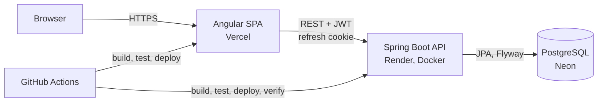

# Overview

InvoiceFlow is an open-source invoicing application for French freelancers and small businesses, built for the
French e-invoicing reform: customers, a product catalogue, and invoices that are right to the cent and carry every
mandatory mention before they are issued.

It is also a portfolio project. This documentation explains **what was built, how, and why**: every choice links to
the code that implements it or to the decision record that justifies it.

## What it does today

| Module | Status | Highlights |
|--------|--------|------------|
| Accounts | Live | Sign-up and sign-in, 15-minute JWT access tokens, rotating refresh tokens with theft detection |
| Customers | Live | Private to each account, paginated search, SIREN / SIRET and VAT number validation |
| Products & services | Live | Goods or service category, prices excluding VAT, French VAT rates (20, 10, 5.5, 2.1, 0 %) |
| Invoices | Live | Drafts with a readiness checklist and live A4 preview, gap-free numbering, issue / cancel / duplicate, overdue tracking |
| Payments | Next | Full and partial payments |
| PDF & Factur-X | Planned | PDF/A-3 with embedded CII data |
| Dashboard, AI assistant | Planned | Revenue and overdue follow-up; natural language to validated draft invoices |

The live roadmap with issues and pull requests is [`PROGRESS.md`](../PROGRESS.md).

## Strengths worth a look

1. **Money is exact end to end.** `BigDecimal` on the server, integer cents (`BigInt`) in the browser, the same
   rounding rules on both sides: the editor preview and the issued invoice cannot disagree. See
   [ADR 0004](adr/0004-exact-money-arithmetic.md).
2. **Gap-free numbering that survives concurrency.** French law forbids holes in the invoice sequence; a locked
   counter row inside the issuing transaction guarantees it, and a test issues invoices concurrently. See
   [ADR 0003](adr/0003-gap-free-invoice-numbering.md).
3. **Authentication done carefully.** Access token in memory, refresh token in an `HttpOnly` cookie, rotation on
   every use and reuse detection (RFC 9700). See [Authentication](authentication.md).
4. **Tenant isolation by default.** Every query is scoped to its owner; another account's data answers `404`, so
   identifiers reveal nothing. See [Security](security.md).
5. **Deploys that verify themselves.** The deploy is pinned to the commit CI tested, then waits until production
   reports that exact commit and passes a smoke test. See [Deployment](deployment.md).
6. **A documented, human-reviewed AI workflow.** Built with Claude Code as an orchestrated team of specialised
   agents; every commit is reviewed by a human. See [Workflow](claude-code/best-practices.md).

## Stack

| Layer | Technology | Why |
|-------|------------|-----|
| Backend | Java 21, Spring Boot 4, Spring Data JPA, Bean Validation, Spring Security (OAuth2 resource server) | Mature, explicit, strongly typed business rules; first-class security |
| Database | PostgreSQL 17 (Neon), Flyway migrations; H2 in tests | Relational integrity for financial data; versioned schema |
| Frontend | Angular 21 (standalone components, signals, zoneless), TypeScript 5.9, Vitest | Structured app with strict typing; fast unit tests |
| Docs | Markdown in the repository, rendered at build time with marked + Shiki, Mermaid diagrams | One source of truth for GitHub and the site |
| CI/CD | GitHub Actions; Vercel (frontend), Render with Docker (backend) | Every merge is built, tested, deployed and verified |

## Architecture at a glance

Details: [Architecture](architecture.md).
